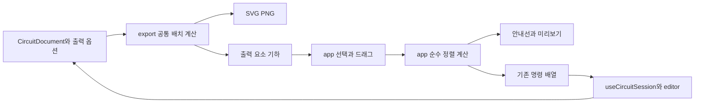

# 출력 정렬 설계

상태: 구현 전 설계, 2026-10-21. 사용자 경험의 확정 사항은 [출력 표기 정렬 기획](../ux/output-alignment.md)에 있다. 공개 API 확장은 [ADR-040](../../decisions/ADR-040-output-alignment.md)의 proposed 제안이며 현재 구현 계약과 구분한다.

기존 OutputCanvas의 드래그와 문서 명령을 유지하면서, 공통 출력 배치 정보와 순수 좌표 계산을 추가한다. maxGraph의 기본 안내선 비교 구조를 참고하고 Excalidraw의 스냅·간격·정렬 계산 중 필요한 부분을 우리 자료형에 맞게 수정한다. 두 앱의 편집기·상태 모델·렌더러나 npm 패키지 전체를 도입하지 않는다.

이 문서는 [UX 기획](../ux/output-alignment.md#문서-읽는-순서)과 [ADR의 제안 근거](../../decisions/ADR-040-output-alignment.md#대안과-영향)에 이어 읽는다. 사용자에게 보이는 동작의 정의는 기획서에 두고, 여기서는 그 동작을 구현할 데이터·계산·명령·검증을 연결한다.

## UX와 구현 검증의 대응

수용 번호는 기획서의 [수용 시나리오](../ux/output-alignment.md#수용-시나리오)를 가리킨다. 구현할 흐름을 고른 뒤 해당 설계 절과 검사 위치를 함께 확인한다. 검사의 실패 조건과 실행 범위는 마지막 [검증 계획](#검증-계획)에 있다.

| 사용자 흐름 | 설계 절과 주요 수정 대상 | 수용 번호 | 검사 위치 |
|---|---|---|---|
| [이름을 끌어 맞추기](../ux/output-alignment.md#흐름-1-이름을-끌어-맞추기) | [공통 배치 정보](#공통-배치-정보-제안)·[스냅 계산](#스냅-계산과-안내선): export, OutputCanvas, app/output-layout | 1, 3, 4 | output-canvas, worksheet-export, notation 및 새 output-alignment 검사 |
| [값의 복수 선택과 영역 선택](../ux/output-alignment.md#흐름-2-값만-여러-개-선택해-정렬하기) | [출력 선택 모델](#출력-선택-모델): App, OutputCanvas, WorksheetPanel | 2, 6, 10 | output-canvas 및 실제 포인터·터치 입력 |
| [정렬 메뉴 실행](../ux/output-alignment.md#정렬-메뉴의-정확한-의미) | [선택 정렬과 간격 분배](#선택-정렬과-간격-분배): app/output-layout, WorksheetPanel | 2, 4, 8 | 새 output-alignment, output-canvas, worksheet-export 검사 |
| [화살표와 간격 맞추기](../ux/output-alignment.md#흐름-3-화살표와-간격-맞추기) | [선택 모델](#출력-선택-모델)·[스냅](#스냅-계산과-안내선)·[명령 조립](#미리보기와-문서-확정): export, OutputCanvas, app/output-layout | 7, 8, 12 | output-canvas, arrow-geometry, circuit-session 및 새 output-alignment 검사 |
| [미세 이동과 취소](../ux/output-alignment.md#입력과-피드백) | [스냅 계산](#스냅-계산과-안내선)·[미리보기와 확정](#미리보기와-문서-확정): OutputCanvas와 제스처 hook | 5, 6, 9 | output-canvas, circuit-session 및 실제 키보드·터치 입력 |
| [복사·저장과 재열기](../ux/output-alignment.md#사용자와-목표) | [공통 배치 정보](#공통-배치-정보-제안)·[문서 확정](#미리보기와-문서-확정): export, 기존 editor·session 경로 | 9, 11 | worksheet-export, editor-persistence, circuit-session |
| [숨김과 작은 화면의 기존 범위 유지](../ux/output-alignment.md#적용-대상과-제외-범위) | [공통 배치 정보](#공통-배치-정보-제안)·[선택 모델](#출력-선택-모델): export, App, OutputCanvas, WorksheetPanel | 10, 12 | worksheet-export, output-canvas 및 작은 화면 확인 |

검사 이름은 아래 검증 계획의 `tests/*.test.ts` 파일명과 대응한다. 외부 코드의 선택 근거는 [재사용 범위](#외부-코드의-재사용-범위), 작업 분할은 [구현 순서](#구현-순서와-완료-경계)에서 이어 확인한다.

## 현재 구현과 변경 이유

| 현재 코드 | 확인한 동작 | 필요한 변경 |
|---|---|---|
| `src/app/OutputCanvas.tsx` | 부모 ID 선택과 내부의 단일 `{ id, part }`, 단일 드래그, SVG 재생성, 도선 근처 주석 삽입 | 출력 부분별 복수 선택, 묶음 이동, 스냅 미리보기, 영역 선택, 안내선 |
| `src/export/index.ts` | `componentTextPlacements`·`annotationTextPlacements`로 위치 계산, SVG 문자열·출력 경계 생성 | 같은 계산에서 정렬용 위치·기준선을 함께 제공. DOM 측정으로 별도 위치 모델을 만들지 않음 |
| `src/app/WorksheetPanel.tsx` | 출력 도구·단일 대상 설정·복사·저장 | 영역 선택·자동 맞춤·정렬 메뉴, 다중 선택 때 단일 대상 명령 보호 |
| `src/app/App.tsx` | 만들기와 출력의 부모 ID 선택 연결, 단일 명령 전달 | 출력 선택 상태를 별도로 소유하고 상단 도구·캔버스에 공유, 묶음 명령 전달 |
| `src/app/useCircuitSession.ts` | `execute(Command \| readonly Command[])`, 모드 검사·자동 저장 | 기존 배열 실행 경로 재사용. 출력에서 물리·회로 구조 명령을 허용하지 않음 |
| `src/editor/index.ts` | `previewCommand`, 원자적인 `executeCommands`, 실패 시 부분 결과 미게시 | 기존 공개 함수 재사용. 새 정렬 전용 도메인 명령은 추가하지 않음 |

현재 export의 `bounds`는 잘림 방지를 위한 보수적인 전체 출력 경계다. 글자 정렬 외곽으로 재사용하면 여백·분수·글자 크기에 따라 눈에 보이는 배치와 달라진다. 정렬용 기하와 파일 출력 여백은 구분해야 한다.

## 책임과 도입 경계



| 경계 | 책임 | 넣지 않는 것 |
|---|---|---|
| `export` | 문서·옵션·공통 표기로 출력 배치와 기하 생성, SVG·PNG와 같은 좌표 보장 | 선택 상태, 포인터, 스냅 정책, React, DOM 측정 |
| `app/output-layout` 제안 폴더 | 출력 선택 정규화, 후보 생성, 스냅·정렬·분배의 순수 계산, 기존 명령 조립 | 회로 해석, 전기 연결 판단, 저장 API, 외부 앱의 Scene/Graph |
| OutputCanvas와 전용 hook | 포인터 수명, 좌표 변환, 임시 선택·드래그 상태, 안내선 레이어 | 영구 문서 직접 수정, 별도 Undo 이력 |
| App과 WorksheetPanel | 도구·메뉴·출력 선택 상태, 설정 패널 연동, 안내 | 스냅 수학과 SVG 문자열 파싱 |
| useCircuitSession와 editor | 출력 모드 제한·학생 권한·검증·일괄 확정·한 번의 Undo | 안내선과 화면 좌표 저장 |
| domain·connectivity·simulation·diagnostics·persistence | 기존 계약 유지 | 스냅·선택·출력 배치용 새 필드와 외부 라이브러리 타입 |

`app/output-layout`은 app 내부의 작은 구현 경계다. 범용 캔버스 프레임워크나 독립 패키지를 만들지 않는다. export 내부 파일을 app에서 직접 import하지 않고 공개 `src/export/index.ts`만 사용한다. export에서 app을 참조하지 않는다.

## 공통 배치 정보 제안

`createSvgExport`의 기존 `svg`, `content`, `bounds`, `options`를 유지하고 파생값 `layout`을 추가한다. 다음은 설계용 타입 윤곽이며 이미 존재하는 타입이 아니다. 최종 이름과 상세 필드는 구현 ADR에 맞춰 확정한다.

```ts
type OutputPart = 'body' | 'label' | 'value' | 'voltage' | 'current' | 'annotation';
type OutputRef = Readonly<{ id: string; part: OutputPart }>;

interface OutputLayoutItem {
  ref: OutputRef;
  kind: 'symbol' | 'text' | 'blank' | 'arrow' | 'point-note' | 'note';
  movable: boolean;
  bounds: Readonly<{ x: number; y: number; width: number; height: number }>;
  referencePoint?: Readonly<{ x: number; y: number }>;
  baselineY?: number;
  path?: readonly Readonly<{ x: number; y: number }>[];
  movesWith?: OutputRef;
}

interface OutputLayout {
  items: readonly OutputLayoutItem[];
  wireSegments: readonly Readonly<{
    wireId: string;
    segmentIndex: number;
    start: { x: number; y: number };
    end: { x: number; y: number };
  }>[];
}
```

- 모든 좌표는 문서 좌표이며 화면 확대율이나 DPI를 포함하지 않는다.
- `layout`은 저장하지 않는다. 같은 문서·옵션·결과에서 같은 순서와 값으로 다시 생성한다. 출력 SVG 내용 자체에 안내선·선택·자동 맞춤 설정을 추가하지 않는다.
- 숨긴 표기는 item 자체에서 제외한다. 사각 빈칸은 실제 사각형의 외곽과 렌더러가 사용한 표기 기준선을 제공한다.
- 글자는 `componentNotationLayout`, `notationMetrics`, `svgNotation`과 같은 계산 근거를 사용한다. 글자 기준선은 placement의 y이며, 분수·첨자의 전체 외곽 중앙과 구분한다. 기존 metric이 해당 표기를 충분히 설명하지 못하면 공통 metric을 보완하고 출력·정렬 양쪽에 적용한다.
- `movesWith`는 화살표 기호·값이 본체 이동을 따라가는 관계만 표현한다. 영구 그룹이나 연결 제약이 아니다. 화살표 본체의 path와 개별 글자 bounds는 분리하고 선택 묶음의 외곽은 app에서 합친다.
- 고정 부품의 중심과 점 주석 위치는 실제 배치의 `referencePoint`로 제공한다. 현재의 48×48 투명 선택 사각형이나 출력 잘림 방지 경계를 기호의 실제 가장자리로 오인하지 않는다. 첫 구현에서 고정 부품은 중심축만 스냅 기준으로 제공한다.
- 도선 구간은 `wirePoints`가 만든 실제 경로를 사용한다. 교차 아치 장식·보이지 않는 연결점·접지 보조 표시는 새로운 스냅 기준으로 삼지 않는다.
- `circuitOnly`의 기존 표현을 유지한다. 출력 기하 제공 때문에 3D 바닥 회로에 출력 표기 위치나 편집 레이어를 섞지 않는다.

## 출력 선택 모델

기획서의 [용어와 선택 단위](../ux/output-alignment.md#용어와-선택-단위)를 다음 식별자로 표현한다. `part`는 요소 ID와 함께 해석하며, 화면에서 말하는 모든 본체를 `body`로 표현하지 않는다.

| 화면 대상 | `OutputRef.part` | 선택 처리 |
|---|---|---|
| 전기 부품 기호 | `body` | 이동 집합에서 제외하고 표시 설정 진입만 유지 |
| 부품 이름·값·전압·전류 | `label`, `value`, `voltage`, `current` | 각 부분을 독립 선택. 값의 저장 offset 접두어는 기존 `answer` 사용 |
| 화살표 본체 | `annotation` | 선택 시 본체와 딸린 표기를 한 이동 단위로 정규화 |
| 화살표 기호·값 | `label`, `value` | 본체가 선택되지 않았을 때 독립 선택 |
| 점 주석·일반 글자 주석 | `annotation` | 기존 주석 단위 유지 |
| 화살표 길이 손잡이 | 선택 모델에 없음 | 기존 `start`·`end`는 길이 조절 제스처 대상으로만 사용 |

출력의 `selectedParts: readonly OutputRef[]`를 App의 출력 전용 상태로 소유한다. 만들기·분석의 부모 ID 선택과 혼용하지 않는다. 단일 선택인 경우에만 부모 ID를 기존 표시 설정에 전달한다. 고정 부품 클릭의 표시 설정 진입은 별도로 유지한다.

선택 상태에는 문서 ID·유효한 부분 식별자를 사용하고 SVG DOM 객체를 보관하지 않는다. 현재 `dangerouslySetInnerHTML` 재생성 후에도 같은 부분을 다시 찾을 수 있어야 한다. 렌더링한 부모 annotation의 DOM bounding box는 자식 글자까지 포함하므로 독립 표기 선택에 사용하지 않는다.

정규화 순서는 다음과 같다.

1. 존재하고 보이는 이동 가능 부분만 남기고 중복을 제거한다. 전기 부품 기호의 `body`와 도선은 이동 집합에 넣지 않는다.
2. 화살표 본체가 선택되면 그 기호·값의 별도 선택을 제거한다. 본체 선택 윤곽에는 함께 움직일 글자를 포함한다. 글자만 선택한 경우에는 독립 선택을 유지한다.
3. 영역 선택은 각 부분의 실제 외곽이 상자에 완전히 들어오는지 판정한다. [UX의 화살표 예외](../ux/output-alignment.md#흐름-2-값만-여러-개-선택해-정렬하기)에 따라 본체는 경로·화살촉 외곽으로 포함을 판정한 뒤 2번 규칙을 적용한다. 상자 밖의 딸린 글자도 함께 이동하므로 묶음 전체 윤곽을 놓기 전에 보여 준다.
4. 문서 변경·숨김·삭제·Undo/Redo 후에는 유효한 부분만 유지한다. 출력 모드 이탈·문서 교체에서는 선택과 진행 상태를 정리한다.

단일 화살표 본체만 선택했을 때 길이 손잡이를 제공한다. 손잡이는 선택 집합에 들어가는 요소가 아니라 제스처 종류다. 키보드 초점과 실제 선택은 별개이며 Tab만으로 그룹 이동 대상을 바꾸지 않는다.

App의 전역 선택·복사·삭제 단축키가 출력 부분 선택을 만들기 화면의 부모 ID 선택으로 해석하지 않게 한다. 다중 선택 중 단일 대상 삭제·속성 변경을 첫 번째 ID에 실행하지 않는다. 기존 `그림 복사` 동작은 선택과 관계없이 확정된 전체 출력 문서를 사용한다.

## 스냅 계산과 안내선

순수 계산의 입력은 시작 배치, 정규화한 선택, 원래 포인터 변위, 화면 변환 축척, 사용 가능한 기준, 이전에 붙은 후보다. 결과는 보정한 문서 변위와 안내선 데이터다. 함수 안에서 문서·SVG·React 상태를 변경하지 않는다.

### 좌표와 후보

화면 입력은 SVG의 역 CTM으로 문서 좌표로 변환한다. 현재처럼 확대만 있는 경우 축척으로 나눌 수 있으나 X·Y축의 화면 길이를 각각 처리해 장래에 잘못된 비등방 확대를 가정하지 않는다. 드래그 중 화면 변환이 바뀌면 취소하고 새 제스처에서 다시 측정한다. 포인터 이동은 항상 시작 위치 기준이며, 직전 보정 위치에 변위를 누적하지 않는다.

기본 후보는 이동하지 않는 보이는 표기의 가장자리·중앙·글자 기준선, 자기 부품 중심, 관련 도선 구간이다. 선택 묶음은 하나의 외곽으로 이동하되 실제로 함께 움직이는 글자 기준선도 후보 생성에 사용할 수 있다. 이동 집합과 그 종속 글자는 고정 후보에서 모두 제외한다.

새 주석 추가의 기존 `snapToWire`는 별도 입력 단계로 유지한다. 기존 8 CSS px 거리와 도선 투영 계산을 재사용하되 자동 맞춤 토글·Alt가 적용 여부를 결정한다. 도선 위로 추가한 주석도 전기 연결이나 지속 앵커를 새로 만들지 않는다.

현재 뷰포트 안에 보이는 기준만 사용한다. 일반 후보는 수직인 축의 표시 외곽 사이 거리가 160 CSS px 이내일 때 사용한다. 자기 부품 중심은 이 거리 필터를 면제하되 실제 스냅 축의 거리 제한은 지킨다. 도선은 UX 문서에 정의한 방향·구간 조건을 적용한다. 화살표를 도선과 겹치게 만드는 수직 방향의 흡착 후보는 생성하지 않는다.

### 감도와 후보 선택

초기 감도는 진입 6 CSS px, 이탈 10 CSS px다. 문서 단위 허용 거리는 각 축의 화면 축척으로 나눈다. 이 수치는 UX 검증에서 조정 가능한 초기값이며 외부 라이브러리의 값을 그대로 보증하지 않는다.

1. 기존에 붙은 후보가 유효하고 이탈 거리 안에 있으면 유지한다. 대상이 사라지거나 Alt를 누르면 즉시 해제한다.
2. 새 후보는 진입 거리 안에서 보정 거리가 가장 작은 것을 고른다. 0.5 CSS px 이내 차이는 동률로 보고 자기 부품 중심, 글자 기준선, 동종 표기, 일반 외곽, 같은 간격 순으로 정한다.
3. 여전히 같으면 안정적인 요소 키와 기준 종류 순서로 정해 배열 순서·렌더 프레임에 따라 바뀌지 않게 한다.
4. X·Y축에서 각각 하나의 보정을 선택한다. 실제 적용한 후보만 안내선으로 그린다.

같은 간격 후보는 같은 역할의 표기 또는 화살표 묶음끼리 만들며 수직 방향의 범위가 겹치는 이웃으로 제한한다. 기존 두 요소 사이에 들어가는 동일 간격 위치와 이웃 간격을 연장하는 위치를 계산한다. 겹쳐 있는 쌍의 음수 간격이나 긴 도선을 간격의 한 요소로 사용하지 않는다. 드래그 시작 때 후보를 준비하고 이동 중에는 선택의 가상 위치와 비교한다.

안내선은 app의 별도 SVG overlay에 `pointer-events: none`으로 그린다. X·Y축별 선택된 안내선과 해당 간격 표식만 표시하고, export 내용과 전체 맞춤용 bounds에 포함하지 않는다. 선 굵기와 손잡이 판정 크기는 화면 크기 기준으로 유지한다. 포인터 이벤트가 한 프레임에 여러 번 들어오면 최신 입력으로 한 번만 미리보기를 갱신한다.

드래그 중 Alt의 keydown/keyup은 마지막 원래 포인터 좌표로 미리보기를 다시 계산한다. 포인터를 움직이지 않아도 안내선과 보정이 해제·복원되어야 한다. 이때 입력창의 키 처리나 브라우저 메뉴 조작을 전역에서 가로채지 않고 활성 출력 제스처에만 적용한다.

## 선택 정렬과 간격 분배

명령의 사용자 의미와 활성 조건은 기획서의 [정렬 메뉴](../ux/output-alignment.md#정렬-메뉴의-정확한-의미)를 따른다. 아래는 이를 좌표 변위로 계산하는 방법이다.

정렬은 선택 집합의 시작 기하에서 각 요소의 변위를 한 번에 계산한다. 표기 A를 옮긴 결과를 기준으로 B의 기준을 다시 계산하지 않는다. 기준 요소 고정 상태·페이지 정렬 옵션은 만들지 않는다.

좌우·상하·중앙은 선택 전체 외곽을 기준으로 한다. 글자 기준선은 선택 기준선의 최솟값과 최댓값의 평균이다. 글자·빈칸만으로 이루어진 선택에서만 기준선 명령을 허용한다. 명시적 정렬 명령은 스냅 계산을 거치지 않는다.

간격 분배는 해당 축 시작 좌표로 정렬한 N개 요소의 첫 요소와 마지막 요소를 고정한다. `gap = (마지막 끝 - 첫 시작 - 각 요소 길이의 합) / (N - 1)`로 사이 공간을 계산한다. N이 3 미만이거나 gap이 음수면 실행하지 않는다. 각 안쪽 요소의 다음 시작은 이전 요소의 끝 + gap이다. 반대 축은 유지한다. Excalidraw의 겹침 시 중심 분배로 바꾸는 분기는 가져오지 않는다.

화살표 본체 선택의 단위는 함께 움직이는 표기까지 포함한 묶음 외곽이다. 기호·값만 선택한 경우에는 해당 글자 외곽만 계산에 사용한다. 사용자에게 보이는 선택 윤곽과 계산 외곽이 같아야 한다.

## 미리보기와 문서 확정

1. pointerdown 때 시작 문서·출력 기하·선택·출력 옵션·화면 변환을 고정한다. 실제 드래그 문턱을 넘기 전에는 문서 명령을 만들지 않는다.
2. 원래 포인터 변위에서 스냅을 계산하고 기존 종류의 명령 배열을 조립한다. 미리보기와 확정이 같은 명령 조립 함수를 사용한다.
3. 시작 문서의 독립 사본에 `previewCommand`를 순서대로 적용한다. 하나라도 실패하면 전체 미리보기를 게시하지 않는다. 확정 문서·자동 저장·이력은 변경하지 않는다.
4. pointerup의 최신 좌표와 Alt 상태로 같은 계산을 마지막 한 번 실행한다. 마지막 pointermove가 생략돼도 놓은 좌표를 반영하며 미리보기와 확정 위치가 다르지 않게 한다.
5. 성공한 명령 배열을 기존 `useCircuitSession.execute(commands)`로 넘긴다. 모드 검사와 editor의 활동 권한·문서 검증을 모두 통과해야 한 번의 이력으로 확정된다.
6. 취소·범위 밖 놓기·문서 또는 옵션 변경·입력 중단은 미리보기만 제거한다. 시작 문서가 현재 문서와 다르면 오래된 명령을 확정하지 않는다.

사용하는 문서 필드는 기존 것에 한정한다.

| 대상 | 기존 명령과 필드 |
|---|---|
| 부품 이름·값·전압·전류 | `SetProperties`: `label/answer/voltage/currentOffsetX`, `OffsetY` |
| 화살표 기호·값 | `UpdateAnnotation`: 기존 presentation의 `label/answerOffsetX`, `OffsetY` |
| 화살표·점·일반 주석 본체 | `UpdateAnnotation`: `position`, `anchor: null`, 화살표의 기존 `arrow`와 호환 `end` |

한 부품의 이름·값을 함께 옮기면 속성을 한 `SetProperties`로 합친다. 한 화살표의 기호·값을 각각 옮기면 presentation 변경을 먼저 병합해 한 `UpdateAnnotation`으로 만든다. 시작 presentation을 각각 복사한 두 명령이 앞 변경을 덮어쓰지 않게 한다. 본체와 자식이 같이 선택된 경우 본체 변위만 만들고 자식 offset을 중복 변경하지 않는다.

정렬·이동은 항상 배열 실행 경로를 사용해 무변경 결과의 이력을 방지한다. 단일 동작이라도 배열이 가능하다. 원자적 실행을 우회하는 새 History·Batch 도메인 타입·문서 전체 교체는 추가하지 않는다. OutputCanvas의 dispatch는 app 내부에서 단일/배열 명령을 전달할 수 있게 확장한다.

회로 v6·측정 기록 v5를 유지하며 마이그레이션은 없다. 선택·안내선·자동 맞춤·후보 캐시는 일시적 UI 상태다. 스냅 결과의 최종 오프셋과 주석 위치만 기존 저장 경로로 저장한다. 물리값·단자 ID·부품/도선 기하·계산 결과는 변경하지 않는다.

## 외부 코드의 재사용 범위

검토 기준은 아래 커밋이다. 구현할 때 실제 가져온 구간·수정 내용을 별도로 기록하며 브랜치 최신 코드를 자동으로 받아오지 않는다.

| 출처 | 가져올 구조 또는 계산 | 제거하거나 우리 것으로 대체할 부분 |
|---|---|---|
| [maxGraph Guide.ts](https://github.com/maxGraph/maxGraph/blob/8fa78c2f290fa4521de65583e3e93cf3ca838e8d/packages/core/src/view/other/Guide.ts) | 가장자리·중앙 후보 비교, 작은 오차로 이동량을 보정하는 기본 흐름 | `AbstractGraph`, `CellState`, 도형 생성·overlay·grid 접근. 순수 숫자 입력과 Guide 데이터 반환으로 바꿈 |
| [Excalidraw snapping.ts](https://github.com/excalidraw/excalidraw/blob/1d4dc2c0e6e476911d0760e9c3cf3694f2d43384/packages/excalidraw/snapping.ts) | 확대율에 따른 거리 변환, 축별 후보 비교, 같은 간격 후보·안내선 데이터 구조 | `AppState`, `Scene`, 선택·그룹·전역 SnapCache, bound element 조회. 출력 기하와 제스처 캐시로 대체 |
| [Excalidraw align.ts](https://github.com/excalidraw/excalidraw/blob/1d4dc2c0e6e476911d0760e9c3cf3694f2d43384/packages/element/src/align.ts) | 선택 외곽과 대상 외곽 차이로 이동량 계산 | `scene.mutateElement`, `updateBoundElements`, Excalidraw 그룹. 명령 조립 전에 변위만 반환 |
| [Excalidraw distribute.ts](https://github.com/excalidraw/excalidraw/blob/1d4dc2c0e6e476911d0760e9c3cf3694f2d43384/packages/element/src/distribute.ts) | 요소 길이와 전체 범위에서 같은 빈 간격 계산 | 겹침 시 중심 분배, Scene 변경·binding 처리. 양 끝 고정과 공간 부족 거부를 적용 |

maxGraph의 Apache-2.0 [LICENSE](https://github.com/maxGraph/maxGraph/blob/8fa78c2f290fa4521de65583e3e93cf3ca838e8d/LICENSE)·[NOTICE](https://github.com/maxGraph/maxGraph/blob/8fa78c2f290fa4521de65583e3e93cf3ca838e8d/NOTICE), Excalidraw의 [MIT LICENSE](https://github.com/excalidraw/excalidraw/blob/1d4dc2c0e6e476911d0760e9c3cf3694f2d43384/LICENSE)를 확인했다. 이 문서 작성 단계에서는 외부 소스 코드를 저장소에 복사하지 않았다.

실제 코드를 발췌·변형하면 해당 파일의 저작권·라이선스·원본 커밋·변경 사실을 보존하고 배포물의 제3자 고지에도 포함한다. 기본 가이드와 간격 계산의 출처를 구분해 기록한다. 코드 복사 없이 아이디어만 참고해 새로 구현한 부분도 출처와 채택 이유를 기록하되, 이를 원본 코드를 직접 도입한 것으로 표시하지 않는다.

Moveable·Selecto·interact.js·maxGraph·Excalidraw의 런타임 패키지 의존성은 추가하지 않는다. 외부 코드가 요구하는 타입을 domain으로 옮기거나 upstream 앱의 렌더러·그룹·이력 체계를 재현하지 않는다.

## 구현 순서와 완료 경계

| 순서 | 수정 범위 | 다음 단계로 넘어갈 조건 |
|---|---|---|
| 1 | ADR-040 검토·수용, 관련 요구사항에 수용 기준 반영, export 공통 기하 | 기존 SVG·PNG 표현 유지, 표기/빈칸/분수/회전의 기하와 렌더링 일치 |
| 2 | 출력 부분 선택과 명령 조립, 영역 선택·묶음 이동 | 독립 선택·이중 이동/덮어쓰기 방지·권한 거부·한 번의 Undo·취소 통과 |
| 3 | 기본 위치 스냅·확대율·안내선·Alt·토글 | 놓는 위치와 미리보기 일치, 확대율별 감도와 후보 안정성 확인 |
| 4 | 같은 간격 스냅, 선택 정렬·분배, 도구막대·접근성 | 선택 전체 기준과 공간 부족 정책, 키보드·넓은 화면 터치 확인 |
| 5 | 출력·저장 회귀, 문서 현행화 | 수용 시나리오와 관련 테스트 통과 후 현재 현황 갱신 |

이 순서는 구현 작업의 분할안이다. 현재 요청은 기획·설계 문서 작성이므로 단계 1의 제품 코드 변경부터 별도 구현 착수 범위로 남긴다. 감도 조정은 이 UX 범위 안에서 할 수 있지만 부품 이동·기준 요소 고정·모바일 편집·도선과의 간격 자동 배치 추가는 별도 UX 결정을 거친다.

## 검증 계획

| 검증 | 실제로 방지할 실패 | 기존 검사와 확장 위치 |
|---|---|---|
| 순수 정렬 계산 | 후보 순서에 따른 흔들림, 줌에 따른 거리 변화, 자기 자신 스냅, 음수 간격, 잘못된 기준선 | 새 `tests/output-alignment.test.ts` 제안. 내부 함수 구현을 그대로 재현하는 검사는 피함 |
| 명령·선택 | 이름/값 혼동, 화살표 이중 이동, presentation 덮어쓰기, 부분 성공, 무변경 이력 | `tests/output-canvas.test.ts`, `tests/circuit-session.test.ts`, `tests/editor-persistence.test.ts` 보완 |
| 제스처 | pointerup 최종 좌표 누락, Alt 상태 변경, 취소 후 늦은 확정, 영역 선택/화면 이동 충돌 | `tests/output-canvas.test.ts`와 실제 브라우저 입력 |
| 렌더링 | 분수/첨자/빈칸 기준 불일치, 고정 기호의 가짜 외곽 사용, 안내선 출력 혼입 | `tests/worksheet-export.test.ts`, `tests/notation.test.ts`, `tests/arrow-geometry.test.ts`의 관련 사례 |
| 저장·물리 불변 | 출력 편집이 전기 모델을 바꾸거나 재열기에서 배치가 달라짐 | 기존 worksheet의 물리 불변·왕복 검사와 editor persistence 검사 보완 |
| 모듈 경계 | app 내부나 외부 Scene 타입이 export/domain에 침투 | 변경 시 `npm run check:boundaries`와 타입 검사 |
| 브라우저 수용 | 실제 글꼴과 SVG/PNG 차이, 패널 열림으로 드래그 중단, 터치 두 손가락 오확정 | UX 수용 시나리오 1~12. 50/100/200% 화면 확대와 분수·첨자·사각 빈칸 확인 |

명령·화면·출력에 직접 관련된 검사부터 실행한다. 전체 테스트·전체 verify를 기본으로 추가하지 않는다. 실제 태블릿·보조기술·외부 문서에 붙여넣기는 자동 이벤트 검사와 구분해 검증 결과를 기록한다.
