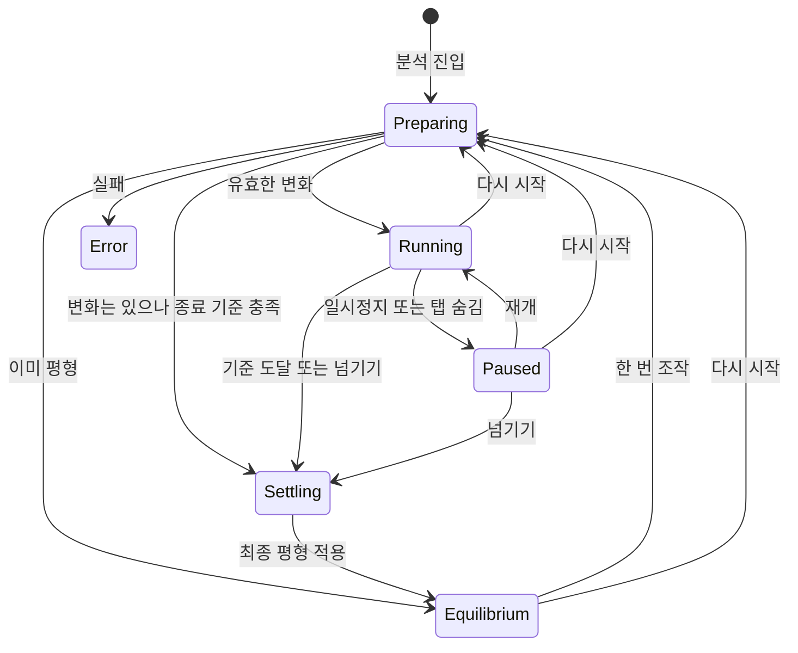

# 선형 RC 관찰 구현 설계

상태: 2026-10-22 dev에서 C0~C4 구현·검증 완료. [C4 결과](../testing/rc-c4-results.md)와 accepted [ADR-045](../../decisions/ADR-045-rc-observation-output.md)에 관찰·기호·입력·기록·출력 경계를 기록했다. C4 검토 후 [C5 기술 확인](../testing/rc-c5-results.md)을 진행했다. 실제 터치 기기·보조기술·수업 사용자 수용은 남아 있다. 2026-10-22 사용자가 dev 커밋·배포를 승인했다. 물리 정본은 [RC 규약](../physics/linear-rc-transient.md), 사용자 흐름은 [UX 기획](../ux/rc-transient.md)을 따른다.

## 목표와 현재 구현의 차이

현재 `SimulationEngine.solve`는 회로 한 장의 DC 결과를 반환한다. `analyzeOperatingCircuit`는 현재 입력에서 물리 모델과 작동 경계를 결정한다. 새 RC 경로는 이전 전하와 새 회로를 함께 받아 **한 번의 조작에 대한 전체 응답**을 준비한 뒤 원하는 시각의 결과를 반환해야 한다.

기존 DC 엔진을 프레임마다 호출해 축전기를 임의의 저항이나 전압원으로 바꾸지 않는다. 연결·회로식 구성·유리수 연산·결과 질의에서 실제로 공통인 부분만 재사용하고, 상태 축약·지수응답·안정화는 simulation 내부의 별도 경로로 둔다.

## 사용자 흐름과 설계의 대응

| 사용자 흐름 | 핵심 책임 | 수용 사례 |
|---|---|---|
| 초기 전압 지정 후 분석 | 문서 초기 조건, 일관성 검사, 진입 스냅샷 | RC-01·05·06 |
| 스위치·저항·전압 한 번 적용 | 후보 회로 사전 계산, 전하 매핑, 원자적 확정 | RC-07·08·15 |
| 여러 축전기의 변화 | 제약 축약, 보존 상태, 감쇠 모드 | RC-02~04·09 |
| 안정화와 넘기기 | 관측량 전체의 남은 변화 상한, 명시적 극한 상태 | RC-10·11·14 |
| 재생·일시정지·배속 | 물리 시각 선택과 일관된 프레임 배포 | RC-12·13 |
| 탐침·기록·출력 | 시간/평형 출처와 품질, 공통 기호 | RC-16~18 |
| 취소·다시 시작·다시 열기 | 세션 무효화, 문서 이력, 버전 변환 | RC-15·19·20 |

번호는 [수용 사례](../testing/rc-transient-cases.md)의 계획 번호다. 단계별 실행 근거와 남은 확인은 해당 결과 보고서로 구분한다. C0 계산 근거는 [결과표](../testing/rc-c0-results.md#검증-결과와-범위), 현재 제품 흐름은 [C4](../testing/rc-c4-results.md)·[C5](../testing/rc-c5-results.md)를 따른다.

## 모듈 경계

| 모듈 | 추가하거나 수정할 책임 | 유지할 경계 |
|---|---|---|
| domain | 축전기·정확 C/초기 전압, 최소 RC 요청·프레임·품질 타입, 새 진단 | 재생·행렬·브라우저 상태를 문서에 넣지 않음 |
| component-library | 공통 기호, 단자, C 단위·기본값, 이름, 출력 치수 | 기호가 전하 계산을 하지 않음 |
| connectivity | 축전기를 2단자 요소로 보존해 컴파일 | 축전기를 도선으로 합치거나 항상 개방으로 지우지 않음 |
| simulation | MNA, 상태 축약, 초기 일관성, 평형, 모드·상한·품질·질의 | 내부 행렬과 수치 정책을 UI에 노출하지 않음 |
| measurement | 동일 프레임의 전압·전류 질의, RC 출처 기록 | 전류 센서가 물리 상태를 변경하지 않음 |
| quantity·notation | F·µF·nF·pF·C 단위와 근사값, 초기 전압 부호 | 표시 자릿수로 물리 상태를 판정하지 않음 |
| visualization·potential-3d·current-view | 같은 프레임의 전위·전류·판 전하 표현 | 입자 이동 시간으로 전하를 적분하지 않음 |
| editor·app 세션 | 명령 권한, 조작 잠금, 후보 확정, 취소, 실험 초기화 | 프레임마다 문서/Undo를 갱신하지 않음 |
| persistence·export | 초기 조건 저장·복원, 시간 출처 기록, 문서 기반 출력 | 현재 전하·재생 위치를 회로 파일에 저장하지 않음 |

다른 모듈에서는 각 공개 index만 import한다. 공통 MNA 파일을 app에서 직접 사용하거나 기존 solver의 비공개 파일을 measurement가 import하지 않는다. 수치 라이브러리 도입은 simulation 내부에 한정하며 외부 엔진의 Scene·회로 저장·UI를 도입하지 않는다.

## C1 데이터와 공개 계약

`ComponentType`에 capacitor를 추가하고 C·초기 전압을 기존 정확 스칼라로 저장한다. C > 0, 두 고정 단자 a/b, 부호 있는 초기 전압을 검증한다. 초기 전압은 회로 설정이므로 문서에 속하고, 계산한 현재 전압은 실행 상태이므로 문서에 속하지 않는다.

기존 `SimulationResult`는 DC 계약으로 유지하고 `RcFrame`을 별도로 정의했다. Rational/StoredScalar의 approximation 판별 타입에 rc-modal/rc-modal-1과 absoluteError를 추가했다. 근사값을 분수로 직렬화하더라도 근사 출처를 보존한다. C1에서 품질·시간 출처를 저장·검증하고 C2에서 수치 상한 산출을 연결했다.

아래는 C1 공개 계약의 요약이다. 정본은 domain 공개 index에서 제공하는 [RC 타입](../../src/domain/rc.ts)이며 simulation index에서도 재수출한다.

```ts
type RcTime = { kind: 'finite'; seconds: number } | { kind: 'equilibrium' };

// InitialState는 부품/단자 ID별 전압과 그 품질을 보존한다.
interface RcEngine {
  prepare(request: RcPrepareRequest): RcResult<RcPlan>;
  sample(plan: RcPlan, time: RcTime): RcResult<RcFrame>;
}
// RcResult: 성공 값 또는 구조화 진단. RcPlan은 엔진 소유의 불변 opaque 타입.
// 공개 요약: 시작/평형 상태, 안정화 시간, 가장 느린 시정수, 정책, 회로 리비전.
// RcFrame: 원래 부품/단자 참조, 같은 시각의 계산 결과·판 전하·품질.
```

C2에서는 RcFrame에 wireCurrents·undefinedWireCurrentIds, RcEngine에 queryWireCurrent를 추가했다. 질의의 수치 실패는 RcReading의 error/diagnostics로 물리적 undefined와 구분한다. 등록된 도선 KCL 합을 prepare의 안정화 관측량에 포함하며, 도선 그래프의 고리와 이상적 제약 전류 자유도를 각각 검사한다.

UI는 plan 내부 행렬을 읽지 않고 공개 요약과 프레임을 사용한다. 작업 스레드에 둘 경우 app 측 어댑터가 요청 ID를 관리하며 핵심 엔진에는 브라우저 Worker·벽시계·네트워크 의존을 넣지 않는다. 취소와 예산 초과는 다른 결과다.

frame에는 회로 리비전·조작 번호·물리 시각 종류·모델/수치 정책 출처가 필요하다. C2의 `rcCircuitRevision`으로 정렬된 전기 입력의 정규형을 만들고 prepare에서 대조한다. 해시 충돌 없이 동일한 입력을 식별하며 화면 기하와 DC 프로필은 제외한다. 양쪽 2D/3D·계기·탐침은 하나의 frame ID로 원자적으로 갱신해야 한다. 스크린샷 시각이나 현재 Date를 물리 경과 시간으로 사용하지 않는다.

## 계산 파이프라인

1. **범위·제약 검사:** 원래 exact 입력과 연결 ID로 지원 요소·C 양수·전압원 충돌·초기 일관성을 검사한다. 입력 배열 순서에 좌우되지 않도록 기준을 고정한다.
2. **조작 전후 상태 매핑:** 축전기 ID와 단자 방향으로 전압을 옮긴다. 새 net 번호로 상태를 복사하지 않는다. 새 연결이 전압 점프를 요구하면 확정 전에 거부한다.
3. **MNA와 축약:** 물리 규약의 `E z' + K z = b`에서 대수 제약, 종속 상태, 기준 자유도를 제거한다. 보존 전하를 추출하고 수동 RC의 `M x' + G x = f` 형태를 검증한다. E를 직접 역행렬로 만들지 않는다.
4. **평형 계산:** 시작 전하 제약을 포함해 x∞를 계산한다. 정확하게 구할 수 있는 성분은 exact 품질을 유지하고 그렇지 않은 것은 수치 오차를 전달한다. 부유 공통 전위와 미정 전류는 질의별로 분리한다.
5. **감쇠 모드:** Cholesky 축약과 대칭 Jacobi로 양의 감쇠율과 관측량 계수의 후보를 준비한다. 정확 회로식에 후보를 대입한 잔차와 초기 불일치에서 에너지 노름 오차 상한을 계산한다. 상한이 예산을 넘으면 거부하며, 작다는 이유로 감쇠율을 0으로 자르지 않는다.
6. **안정화 계획:** 관측 가능한 전체 전압·전류 집합의 상한과 수치 오차를 준비하고 보수적인 T를 찾는다. 반복·탐색 예산을 초과하면 미확인으로 반환한다.
7. **시각 평가:** 요청된 t에서 조작 시작점의 모드를 직접 평가한다. 직전 화면 프레임에서 Euler 적분을 누적하지 않는다. 정확한 구조 관계를 보존하면서 원래 net·부품 결과를 복원한다.
8. **결과 수용:** KCL·KVL·전하·에너지 및 수치 품질을 검사해 성공·비유일·미확인·실패를 구분한다. 정상 프레임과 진단을 한 결과로 전달한다.

범용 행렬 고유분해를 아무 회로에나 적용하지 않는다. 수동 대칭 형태를 확인한 경우에만 모드 상한을 사용한다. C0는 고유값 간격에 의존하지 않는 잔차 에너지 상한으로 중복·근접 모드를 검증한다. 동일한 후보 감쇠율은 합치고 비슷한 감쇠율은 유지한다. 입력 순서에 따른 결과와 진단은 재현되어야 한다. 불확실한 작은 양의 모드를 누설 없는 영구 보존 모드로 오분류하지 않는다.

기존 DC의 exact 예산은 구조적 rank·모순 검사에 재사용을 검토한다. 이 예산을 넘었다고 구조적 0 판정을 무검증 binary64로 대체하지 않는다. 수치 축약이 신뢰성을 확보하지 못하면 범위 미확인으로 반환한다.

### 계산 예산과 수치 검증 관문

C0 예산은 축전기 32개·독립 저장 상태 최대 32개·노드와 이상적 제약 가지 합 256개, 정수 4096 bit·GCD 나머지 500만 회·Jacobi 80 sweep·안정화 상한 확장 256회·이분 탐색 80회다. 16단 사다리는 통과했으나 32단은 GCD 예산으로 거부됐다. 개수 상한을 지원 보장으로 표시하지 않는다. FPS나 실행 시간에 따라 회로를 다른 모델로 바꾸지 않는다.

`rc-c0-envelope-1`의 허용량과 **수치 오차 예산 1%**를 구분한다. C0는 정확 초기 상태·평형을 사용하고, 모드 후보의 실제 응답 오차를 에너지 상한으로 덮으며 지수 평가는 구간 연산으로 덮는다. prepare와 개별 sample이 각각 실패할 수 있다. 상한의 유도·독립 90자리 기준 비교·진단 범위는 [C0 결과](../testing/rc-c0-results.md)에 둔다. 검증 가능한 수치 오차 상한을 확보하지 못한 영역은 지원 밖 결과로 남긴다.

C0는 외부 수치 패키지 없이 기존 rational 공개 API·자체 Jacobi·오차 인증을 사용한다. 독립 기준 생성에는 Python 표준 Decimal의 직접 행렬 지수를 사용했다. C2도 이 수치 경로를 사용하며 도선 KCL 관측량을 추가했다. 16단 제품 회로는 통과하고 32단은 GCD 예산으로 거부되므로 큰 회로 비용 개선은 후속 과제다. 범용 라이브러리 교체가 정확 제약·오차 인증 비용까지 해결한다고 가정하지 않는다. [Al-Mohy·Higham 논문](https://eprints.maths.manchester.ac.uk/1300/)은 대안 알고리즘의 근거이며 특정 JS 패키지를 검증했다는 뜻이 아니다. 후속 외부 코드 도입 시 버전/커밋·라이선스·원문·변경점을 기록한다.

## 세션 상태와 명령 확정



모든 상태에서 만들기·출력으로 나가면 실행을 취소하고 세션을 폐기한다. Error는 원인과 이전 유효 상태를 보존하며 수정·다시 시작 경로를 제공한다. 후보 준비 실패는 기존 Equilibrium을 유지하고 오류를 인라인 표시한다.

세션이 보관하는 것은 진입 문서 스냅샷, 현재 확정 문서 리비전, 원래 단자 기준 축전기 상태, 조작 번호, plan, 재생 위치와 배율이다. 저장·공유 원본은 여전히 CircuitDocument다. 새 조작은 다음 절차로 확정한다.

1. 권한·현재 세션 상태를 검사하고 기존 명령으로 후보 문서를 만든다.
2. 이전 평형 상태와 후보 문서로 새 plan을 준비한다. 문서·Undo·전하 상태는 아직 바꾸지 않는다.
3. 완료 시 요청 ID·문서 리비전·세션 세대를 다시 확인한다. 중간에 나가기·초기화·파일 열기가 있었다면 결과를 버린다.
4. 기존 명령 실행 경로로 한 번의 변경을 확정하고 새 plan과 t=0 프레임을 함께 적용한다. 새 명령 권한 거부 시 부분 적용하지 않는다.
5. Running/Paused/Settling에서는 전기 조건 변경을 명령 실행 단계에서 거부한다. 연속 입력을 큐잉하지 않는다.

RC 세션의 Undo/Redo 비활성화는 UI와 명령 검사에서 함께 보장한다. 만들기로 나간 뒤에는 기존 문서 이력만 사용하며 과거 충전 상태를 복원한다고 표시하지 않는다. 다시 시작은 진입 문서 스냅샷과 초기 조건으로 돌아가는 하나의 원자적 명령이다.

## 시계와 평형 전환

재생 시계는 app이 관리한다. `물리 시각 = 시작 시각 + 경과 화면 시간 × 배율`로 요청 시각을 선택하되, 엔진은 전달된 시각만 계산한다. 일시정지·배속 변경 때 기준 시각을 갱신해 점프를 막는다. 탭 숨김 동안의 벽시계 시간을 자동 적산하지 않는다.

기준 T에 도달한 프레임을 확정한 뒤 Settling으로 들어간다. 약 200 ms의 전환 동안 u를 0에서 1로 진행시키고, 예를 들어 `t(u) = t_start + τ_tail × u/(1-u)`로 뒤쪽의 실제 응답을 압축 평가한다. τ_tail은 신뢰 가능한 가장 느린 감쇠 시정수를 사용한다. u=1에서는 식을 계산하지 않고 별도의 equilibrium 결과를 적용한다. 수치 범위를 넘는 프레임은 무한대 숫자를 넣지 말고 오차가 시각 분해능 이하인 tail까지만 평가한 뒤 최종 프레임으로 전환한다.

이 시간 압축은 물리 계산을 선형 보간하지 않는 표현 구현안이다. 해당 구간에는 정상 시간 숫자와 기록을 제공하지 않는다. 넘기기 역시 같은 plan의 최종 상태를 사용하며 직전 화면 프레임을 초기값으로 재적분하지 않는다. 중간 파손 사건이 없는 이상적 RC 범위이므로 넘기기가 별도의 위험 판정을 우회하는 일이 없도록 모델 범위를 유지한다.

## 계기와 시각화

프레임 단위로 기존 queryVoltage/queryCurrent와 동등한 유일성 질의를 제공한다. 동적 제약으로 전압차가 결정되는 두 net을 DC에서 분리된 기준이라는 이유로 무조건 비교 금지하지 않는다. 반대로 실제 미정인 공통 전위·고리 전류에는 숫자를 만들지 않는다.

current-view의 표시 시계는 그대로 표현용이다. 전류 크기·방향은 RC 프레임을 따르고 입자가 축전기 유전체를 관통하지 않게 별도 내부 경로 정책을 등록한다. 기존의 수동 조절 중 점열 숨김 정책을 RC 전체 재생에 그대로 적용하면 충전 전류가 보이지 않으므로, 진짜 시간 응답을 표시하는 경로는 별도로 처리한다. 불확실한 부호에는 방향성 입자를 표시하지 않는다.

지속 변화하는 계기 숫자를 보조기술에서 매 프레임 읽지 않는다. 시작·일시정지·평형·오류를 알리고, 정지 시 측정값을 읽을 수 있게 한다. 모션 감소는 물리 시각·수치를 유지하고 이동 연출을 줄이며 평형 전환은 즉시 처리한다.

축전기 기호는 국내 대상 학년 교과서 또는 공공 교육자료를 구현 전에 확인하고 근거를 남긴다. 두 평행판·리드·초기 전압 방향은 하나의 공통 정의를 사용한다. `symbolBody`는 판 본체만 포함하여 기존 이름/값 간격 스냅에 연결하고, 180° 반대 방향 비교와 출력 기호도 같은 정의를 사용한다.

## 저장과 호환성

C1에서 **회로 v7·측정 기록 v6**를 구현했다. 이전 회로 v6·기록 v5 스키마는 복원 전용으로 고정한다. 현재 스키마에 실행 상태를 숨겨 저장하지 않는다. 정확한 필드·지원 버전·키·롤백은 ADR-042를 따른다.

| 데이터 | 저장 범위 |
|---|---|
| 회로 v7 | 축전기 타입·정확 C·정확 초기 전압·단자·표시 설정. 현재 전하/시계/plan 제외 |
| 측정 기록 v6 | 기존 값·방향·조건·품질에 RC 모델/정책, 조작 번호, finite 시간 또는 equilibrium 추가 |
| 실행 세션 | 현재 축전기 상태·진입 스냅샷·재생 위치. 새로고침 시 복원 대상 아님 |

정상 로드는 새 현재 버전만 받는다. 기존 v6 회로는 검증 후 명시적 복원에서 v7로 변환하며, 기존 v5→v6 복원 지원은 검증된 v5→v6→v7 단계 변환으로 유지한다. 변환 실패·미래 버전·참조 오류에서는 원문을 보존하고 덮어쓰지 않는다. 기존 측정 기록 v5는 시간 출처를 만들어 넣지 않고 기존 DC 기록으로 변환한다. 기록은 새 v6 키가 없을 때에만 고정 v5 스키마와 스냅샷 검증 후 복사하며 이전 키·백업을 보존한다. 현재 키가 있으면 구버전으로 되돌리지 않는다.

동작 중 문서 저장은 현재 확정된 스위치/저항/전압 설정과 원래 초기 조건을 저장한다. 재열기는 그 초기 조건에서 시작하며, 저장 순간의 충전 상태가 이어진다고 안내하지 않는다. 내보내기·CSV에도 finite/equilibrium과 근사 출처를 보존한다.

## 구현 순서와 관문

| 단계 | 산출물 | 다음 단계로 넘어갈 조건 |
|---|---|---|
| C0 엔진 타당성 | 독립 계산 시제품, 단일/다중 RC 기준 사례, 오차·시간 상한 검증 | [제한된 수치 범위에서 검증 완료](../testing/rc-c0-results.md). 자체 수치 구현·예산 확정, 32단 예산 초과 한계 기록 |
| C1 계약과 저장 | accepted ADR·요구사항, 축전기 타입, 회로/기록 버전·복원 | [계약·저장 구현 및 검증](../testing/rc-c1-results.md). 이후 C2 엔진·C3 세션·C4 관찰까지 연결 |
| C2 순수 엔진 | prepare/sample, 구조화 실패, RC·도선 질의와 최종 평형 | [제품 경로 검증 완료](../testing/rc-c2-results.md). 고정 예산과 정확 평형 승계, 같은 입력/시각 재현 |
| C3 세션과 조절 | 잠금·원자적 적용·초기화·재생·넘기기 | [구현·검증](../testing/rc-c3-results.md). 오래된 결과 차단·한 번의 Undo·UI 우회 입력 차단 |
| C4 관찰과 출력 | 2D/3D·계기·기록·공통 기호·출력 | [구현·검토 완료](../testing/rc-c4-results.md). 동일 프레임·인증 측정·출력 초기 조건과 저장 호환 확인 |
| C5 수용 확인 | 데스크톱·터치·키보드의 대표 흐름 | [브라우저·키보드·작은 화면·자동 터치·계산 비용 확인](../testing/rc-c5-results.md). 실제 기기·수업 사용자 확인 대기. 2026-10-22 dev 배포 승인, 공개 상태는 release.json으로 확인 |

2026-10-22 사용자가 dev의 C0~C5 구현·검증 진행을 승인했다. C0 수치 코드는 tools/rc-prototype에 격리했고 C1 공개 계약·저장은 src에 구현했다. C2 수치 코드는 simulation 내부에 연결했고 C0 도구는 기준 구현으로 고정했다. C3는 app의 RcSession과 useCircuitSession에 연결했다. C4는 공통 관찰 어댑터와 축전기 UI를 연결하고 검토했으며 C5 기술 확인을 마쳤다. 기술 검사 통과를 사용자 수용·배포 승인으로 간주하지 않는다. 수치 검증이 실패한 입력은 약한 기준으로 성공 처리하지 않는다. 기존 DC·다이오드 동작을 RC 실패의 우회 경로로 사용하지 않는다.
